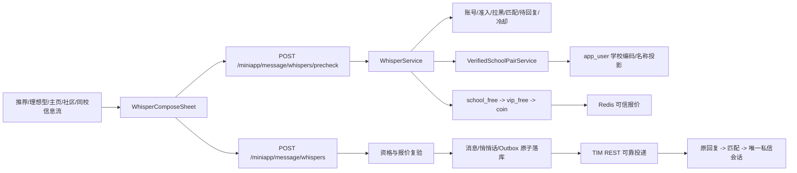
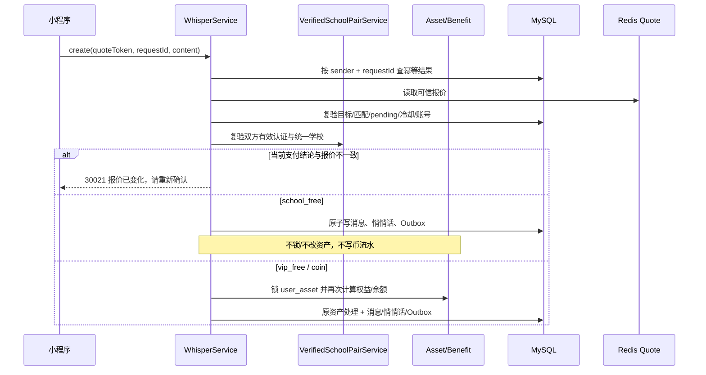

# 同校免费悄悄话技术方案

> 日期：2026-10-22
> 需求编号：`APP-03-RULE-school-free-whisper`
> 需求状态：已确认，已实施
> 方案状态：技术方案与代码实现已完成
> 采用技能：`techni-design`

## 1. 背景、目标与范围

### 1.1 输入基线

本方案以下列正式文档和当前代码为输入基线：

- `docs/需求文档/需求文档-正式版/定稿：03-消息、私信与通知中心/同校免费悄悄话-需求文档.md`
- `docs/需求文档/需求文档-正式版/定稿：03-消息、私信与通知中心/PRD-03_模块公共定义.md`
- `docs/需求文档/需求文档-正式版/定稿：04-商业化（VIP、千寻币、解锁与资产中心）/PRD-04_模块公共定义.md`
- `docs/需求文档/需求文档-正式版/全局定义/共享层_项目级.md`
- `docs/技术方案/2026-07-31-消息、私信与通知中心-tcdesign.md`
- 当前 `WhisperController`、`WhisperServiceImpl`、学历认证审核记录、学校字典、小程序统一悄悄话弹窗及管理后台消息查询实现。

原 `docs/需求文档/同校免费悄悄话-需求确认稿.md` 只作为需求形成过程记录，不作为开发口径；正式版需求已明确采用“免费悄悄话、回复后再转私信”的方案 A。

### 1.2 建设目标

1. 发送方按现有同校信息流规则能够查询到接收方时，发送悄悄话费用类型为 `school_free`。
2. 同校免费不扣千寻币、不核销会员每日免费次数，也不依赖余额或会员状态。
3. 保留现有待回复唯一性、7 天有效期、7 天冷却、账号/准入/拉黑/处罚限制、TIM 可靠投递和回复后原子转私信流程。
4. 推荐、理想型、用户主页、社区动态/评论、同校信息流等已有入口共用同一服务端判定，不在客户端自行判断同校。
5. 预检查和提交时都读取双方最新 `app_user.school_code/school` 投影；资料变化时不得静默转为扣币/会员核销。
6. 后台能准确区分 `school_free`、`vip_free`、`coin`，且旧记录不追溯修改。

### 1.3 不在本期范围

- 不开放同校用户未匹配直接私信。
- 不新建同校关系、同校会话、同校消息列表或独立后台菜单。
- 不新增同校免费次数配置；同校免费本身无每日/累计额度。
- 不改变图片、语音等消息类型范围。
- 不追溯退还历史千寻币或会员次数。
- 不以客户端参数或同校 Tab 来源直接决定免费；服务端使用与同校列表一致的资料学校投影规则。
- 不改变学历认证的提交、审核、失效流程。

### 1.4 成功标准

- 正式需求第 6 节 15 条验收场景全部有明确的实现点与测试点。
- `school_free` 记录的千寻币变化量、会员次数变化量、资产流水数量均为 0。
- 报价后认证学校变化时，旧报价提交只返回报价变化，不发生任何资产副作用。
- 同一发送方、接收方并发或跨入口重试最多产生一条有效待回复申请。
- 同校与非同校发送继续复用同一悄悄话状态机、Outbox 和回复转私信链路。

## 2. 现状分析

### 2.1 后端现状

| 现状 | 代码证据 | 影响 |
|---|---|---|
| 当前费用类型仅有 `vip_free`、`coin` | `WhisperServiceImpl.PAY_VIP_FREE/PAY_COIN` | 无法表达同校免费事实 |
| 预检查先校验匹配、待回复、冷却，再调用 `resolvePayment` | `WhisperServiceImpl.precheck` | 顺序正确，应在原支付解析器最前增加同校分支 |
| 提交会重新解析支付方式并比较报价 | `WhisperServiceImpl.create/requireSameQuote` | 可复用为资格变化保护，但报价快照需加入学校资格指纹 |
| 当前所有非 `coin` 分支都会更新会员免费次数投影 | `WhisperServiceImpl.create` | 直接增加 `school_free` 会误扣会员次数，必须改为三分支处理 |
| 提交统一锁定 `user_asset` 并更新时间 | `WhisperServiceImpl.create` | 同校免费不应产生资产消费语义，需让同校分支跳过资产写入 |
| 同一对象待回复查询和数据库唯一约束已存在 | `AppMessageWhisperDao.selectActivePair`、`app_message_whisper` | 继续复用，不新增次数表 |
| 学历审核通过会投影 `school_code/school` | `AppUserAuditServiceImpl`、`app_user` | 同校列表与同校免费统一读取该投影，避免两套口径 |
| 同校列表兼容历史无编码用户 | `CommunityServiceImpl` | 同校免费必须复刻相同的“编码优先、名称兜底”方向性规则 |
| 学校字典只有 `school_code`，没有校区归并字段 | `school_dictionary` | 仅比较原始编码无法可靠保证“同校不同校区” |
| `app_message_whisper.pay_type` 为 `VARCHAR(20)` | `070_prd03_message_center_closure.sql` | 已能存储 `school_free`，无需扩大字段 |

### 2.2 小程序现状

| 现状 | 影响 |
|---|---|
| 多个入口已复用 `WhisperComposeSheet` 与同一预检查接口 | 适合统一落地，不在各页面增加学校判断 |
| `CommunityWhisperSheet` 通过 `free` 推断“会员今日免费” | 会把同校免费错误展示成会员免费及剩余次数 |
| 成功提示只区分 `vip_free` 与其他 | `school_free` 会被错误提示为“消耗 0 千寻币” |
| `WhisperCreateResponse.payType` 仅声明 `'vip_free' | 'coin'` | 类型契约必须增加 `school_free` |
| `whisper-detail.tsx` 仍有一套直接发起/反向申请报价展示 | 必须同步改造，不能只改统一弹窗 |

### 2.3 管理后台现状

- 后端悄悄话查询已经返回 `payType`，但页面主要展示状态、投递结果和时间，未提供费用类型中文映射。
- 本期不增加后台页面或配置，只在已有 App 用户“心动 & 消息”、消息记录/导出中准确展示 `同校免费`。
- 正文查看、举报证据、RBAC 和审计逻辑不受影响。

## 3. 方案比较与选型

| 方案 | 做法 | 优点 | 风险/不足 | 结论 |
|---|---|---|---|---|
| A. 有效认证 + 学校主标识 | 读取当前有效学历认证并通过学校字典归并 | 认证边界严格 | 与现有同校列表不一致，出现“列表可见但不免费” | 原方案，已废止 |
| B. 同校列表投影规则 + 原链路扩展 | 读取 `app_user.school_code/school`，按同校列表的方向性规则匹配；扩展现有报价、创建、记录和 UI | 用户认知一致；兼容历史无编码用户；不复制消息/关系状态机 | 依赖资料投影及时更新 | **采用** |
| C. 独立同校权益/申请系统 | 新建同校权益表、发送接口、列表和状态机 | 隔离彻底 | 与现有悄悄话重复，容易产生双列表、双会话和状态不一致 | 不采用 |

## 4. 已锁定技术决策

| 决策 ID | 决策 |
|---|---|
| `TDSFW-01` | `app_user.school/school_code` 是同校列表与同校免费共同的数据源；客户端传参不参与费用决策 |
| `TDSFW-02` | 匹配按发送方视角执行：发送方有编码时匹配同编码，或兼容接收方无编码但同名；发送方无编码时精确匹配学校名称 |
| `TDSFW-03` | 在 `common` 增加 `VerifiedSchoolPairService`，只返回资格结论及内部主标识，不向普通移动端接口暴露对方认证材料 |
| `TDSFW-04` | 费用优先级固定为 `school_free -> vip_free -> coin`，统一由 `WhisperServiceImpl` 服务端计算 |
| `TDSFW-05` | 报价快照绑定发送方、接收方、来源、费用类型、金额、规则版本和学校资格指纹；提交必须复验并与快照严格比较 |
| `TDSFW-06` | 旧报价与当前资格不一致时统一返回现有 `30021` 报价变化语义，要求前端刷新并重新确认；不得自动切换到其他支付分支 |
| `TDSFW-07` | `school_free` 不锁定/修改币余额、不更新会员免费次数投影、不更新时间为资产消费、不写千寻币流水，也不产生虚假退款/补偿 |
| `TDSFW-08` | `school_free` 继续写入原 `app_message_whisper`、`app_message_record` 和投递 Outbox，继续使用原待回复唯一约束、生命周期及回复转私信事务 |
| `TDSFW-09` | `app_message_whisper.school_code_snapshot` 保存学校编码或学校名称的不可逆哈希，仅用于内部审计；移动端普通响应和导出不返回该字段 |
| `TDSFW-10` | 明确不满足同校列表学校匹配规则时进入原会员/千寻币分支；同校但交友权限不开放时继续失败关闭 |
| `TDSFW-11` | 不新增业务配置和后台开关；规则与现有消息安全总开关、有效期、冷却期配置共同生效 |
| `TDSFW-12` | 历史 `vip_free`、`coin` 不回填；资格变化只影响新报价和新申请，历史消息、匹配、会话不删除、不重算 |

## 5. 总体架构



### 5.1 权威数据边界

| 事实 | 权威来源 | 说明 |
|---|---|---|
| 当前学校编码 | `app_user.school_code` | 与同校信息流查询使用同一资料投影 |
| 当前学校名称 | `app_user.school` | 历史无编码数据按精确名称兼容，不做模糊匹配 |
| 学校匹配快照 | 编码或学校名称不可逆哈希 | 不向客户端下发；用于报价复验和内部审计 |
| 核心准入 | `RelationAccessProjectionService` | 发送方沿用原校验；同校分支还要确认接收方为 `OPEN` |
| 悄悄话状态 | `app_message_whisper` | 不新增同校申请表 |
| 费用事实 | `app_message_whisper.pay_type/coin_amount` | `school_free` 的 `coin_amount=0` |
| 会员次数 | 成功 `vip_free` 事实计数及现有权益配置 | `school_free` 永不进入计数 |
| 币余额及流水 | `user_asset`、`user_coin_log` | `school_free` 不写消费/退款流水 |

## 6. 核心领域设计

### 6.1 统一学校资格服务

新增公共领域接口，放在 `common`，供消息模块复用，不允许 `miniapp` 与 `admin` 相互引用：

```java
public interface VerifiedSchoolPairService {
    VerifiedSchoolPairResult resolve(AppUser sender, AppUser receiver);
}

public record VerifiedSchoolPairResult(
        boolean sameSchool,
        String canonicalSchoolCode,
        String qualificationFingerprint,
        String reasonCode) {
}
```

判定步骤：

1. 从调用方已加载的 `AppUser` 读取双方 `schoolCode/school`，统一去除首尾空格，编码转大写比较。
2. 发送方有学校编码：接收方编码相同则同校；接收方编码为空且学校名称完全相同也判定同校。
3. 发送方无学校编码：双方学校名称完全相同则同校，接收方是否已有编码不影响结果。
4. 双方非空学校编码不同：即使学校名称相同也明确判定非同校，进入原支付规则。
5. 同校后继续检查双方核心准入均为 `OPEN`。
6. 返回同校结论、学校匹配快照和资格指纹。资格指纹为：

```text
SHA-256(senderId + ':' + receiverId + ':' + 双方学校编码及名称投影)
```

资格指纹仅进入 Redis 报价快照和服务日志摘要，不返回客户端。

### 6.2 支付选择器

将当前 `resolvePayment(senderUserId, asset, coinPrice, now)` 重构为语义明确的支付选择器：

```text
resolveWhisperPayment(sender, receiver, now):
  school = verifiedSchoolPairService.resolve(sender, receiver)
  if school.sameSchool:
      require receiver core access OPEN
      return SCHOOL_FREE(amount=0, quotaConsumed=0, schoolSnapshot)

  asset = load sender asset
  if active VIP and remaining quota > 0:
      return VIP_FREE(amount=0, quotaConsumed=1)

  return COIN(amount=currentWhisperPrice, quotaConsumed=0)
```

`PaymentChoice` 应从仅包含费用结果，扩展为：

- `payType`
- `coinAmount`
- `freeRemain`
- `freeDailyQuota`
- `consumeVipQuota`
- `canonicalSchoolCode`
- `qualificationFingerprint`

为兼容已发布报价结构，字段名 `canonicalSchoolCode` 暂不改名；新口径下它承载“学校匹配快照”：编码匹配时保存标准化编码，学校名称兜底时保存名称的 SHA-256，不保存原始名称。

不得继续使用“所有非 coin 都是会员免费”的 `else` 写法。

### 6.3 预检查流程

保持当前顺序，只扩展费用阶段：

1. 全局发送安全开关。
2. 发送方核心准入、接收方账号正常、目标合法。
3. 已匹配则返回已有私信；已有 `pending` 则返回现有申请。
4. 拉黑、处罚、冷却和规则版本校验。
5. 调用统一学校资格服务。
6. 按 `school_free -> vip_free -> coin` 生成支付选择。
7. 生成可信报价并写 Redis，TTL 继续沿用 10 分钟。
8. 返回展示数据。

同校报价响应示例：

```json
{
  "canSend": true,
  "payType": "school_free",
  "coinAmount": 0,
  "free": true,
  "freeWhisperRemain": 1,
  "freeWhisperDailyQuota": 1,
  "freeWhisperExhausted": false,
  "confirmText": "本次同校免费，不消耗千寻币及会员免费次数",
  "quoteToken": "opaque-token"
}
```

兼容约束：

- 保留 `free` 字段，定义为 `payType != coin`，避免旧客户端直接失效。
- 客户端展示不得再用 `free` 推断会员免费类型，必须以 `payType` 为准。
- 同校报价仍返回当前会员剩余次数，但该值只用于展示资产现状，不表示同校额度，也不会因本次发送减少。

### 6.4 提交复验与事务



关键约束：

- `quote.payType=school_free` 但提交时不再同校：返回 `30021`，不能自动改为 `vip_free` 或 `coin`。
- `quote.payType=vip_free/coin` 但提交时变为同校：也返回 `30021`，让用户看到新的免费说明后重新确认。
- 学校资格查询异常：事务失败且无资产副作用。
- `school_free` 分支：
  - 不调用 `updateCoinBalance`；
  - 不调用 `updateFreeWhisperProjection`；
  - 不调用代表消费行为的 `updateLastConsumeTime`；
  - 不插入 `user_coin_log`；
  - `benefit_date`、`quota_snapshot`、`asset_consume_flow_no` 均为 `NULL`；
  - `payment_status=paid` 只表示本次费用结算完成，不表示发生资产扣减。
- 原 `senderUserId + requestId` 幂等和活动对象唯一约束继续兜底跨入口并发。

### 6.5 消息投递、失败与补偿

`school_free` 创建成功后完全复用现有消息主表与 TIM Outbox：

1. `app_message_record` 写原悄悄话正文和 `queued` 状态。
2. `app_message_whisper` 写 `pay_type=school_free`、`coin_amount=0`、学校主标识快照。
3. `app_message_delivery_outbox` 写元数据，不写正文。
4. TIM 投递成功后进入原 `pending` 状态与列表。
5. 投递永久失败时申请进入原失败/失效处理，但因为没有资产消费，不创建退币、会员次数补发或零金额补偿流水。

现有 `MessageWhisperCompensationServiceImpl` 必须显式识别三种费用类型：

- `coin`：按原规则退币；
- `vip_free`：按现有事实计数模式处理，不伪造币流水；
- `school_free`：只迁移消息/申请失败状态，资产补偿为 no-op，并记录结构化原因。

### 6.6 回复转私信

同校免费不改变回复行为。继续复用：

- `pending -> replied` 状态迁移；
- `whisper_reply` 匹配来源；
- 唯一匹配、唯一私信会话；
- 回复消息、会话未读、TIM 投递和补偿；
- 女性保护和私信发送权限。

禁止新增 `same_school` 匹配来源或“同校会话”类型，否则会破坏现有关系与会话唯一性。

## 7. 数据库设计

本节字段已随原方案上线并继续保留兼容，但 `canonical_school_code` 不再参与免费资格判定。`school_code_snapshot` 在名称兜底分支保存不可逆哈希。

### 7.1 `school_dictionary`

新增字段：

```sql
ALTER TABLE school_dictionary
  ADD COLUMN canonical_school_code VARCHAR(64) NULL
    COMMENT '统一学校主标识；同一学校不同校区使用相同值' AFTER school_code,
  ADD KEY idx_school_canonical_code (canonical_school_code, status, deleted);
```

迁移步骤：

1. 初始回填 `canonical_school_code = COALESCE(NULLIF(school_code, ''), provider_uuid)`。
2. 根据正式校区归并清单，把同一学校不同校区记录更新为相同主标识。
3. 校验所有启用字典行主标识非空、原始学校编码唯一可解析。
4. 校验通过后，应用层将启用学校主标识为空视为系统数据异常。

不在首版增加校区映射后台页面；归并清单作为受版本管理的生产迁移/运维数据维护，后续需要运营维护时再独立立项。

### 7.2 `app_message_whisper`

新增内部审计快照：

```sql
ALTER TABLE app_message_whisper
  ADD COLUMN school_code_snapshot VARCHAR(64) NULL
    COMMENT 'school_free 创建时使用的学校匹配快照' AFTER pay_type;
```

同时更新 `pay_type` 注释为：

```text
费用类型：school_free-同校免费，vip_free-会员次数免费，coin-千寻币
```

存储约束：

| `pay_type` | `coin_amount` | `benefit_date` | `quota_snapshot` | `school_code_snapshot` | 币流水 |
|---|---:|---|---|---|---|
| `school_free` | 0 | `NULL` | `NULL` | 必填 | 无 |
| `vip_free` | 0 | 原规则 | 原规则 | `NULL` | 无 |
| `coin` | 大于等于 0 的有效报价 | `NULL` | `NULL` | `NULL` | 有实际扣费时写 |

建议在实体写入前做 Java 领域校验，并增加数据库迁移契约测试；不使用数据库 `ENUM`，保留现有 `VARCHAR(20)` 兼容历史值。

### 7.3 不新增的数据表

- 不新增同校免费次数表；无限总次数无需计数。
- 不新增同校关系表；同校只是发送当刻的费用资格。
- 不新增同校报价表；继续使用 Redis 短期可信报价。
- 不新增同校消息/会话表；继续使用消息主表、悄悄话表和会话表。

## 8. 接口契约

### 8.1 复用接口

| 接口 | 变化 |
|---|---|
| `POST /miniapp/message/whispers/precheck` | `payType` 增加 `school_free`；同校返回专用 `confirmText`；资格依赖异常直接失败 |
| `POST /miniapp/message/whispers` | 接受原请求，不新增客户端学校参数；提交复验同校资格；响应 `payType` 增加 `school_free` |
| 现有悄悄话列表/详情接口 | 返回记录的真实 `payType` 时允许 `school_free`；不返回学校主标识快照 |
| 现有后台用户消息/消息记录接口 | 返回原 `payType` 字段并支持 `school_free` 中文映射 |

请求 DTO 不增加 `sameSchool`、`schoolCode`、`schoolName`。任何这类客户端字段都不参与费用决策。

### 8.2 类型定义

后端建议增加固定枚举，替代字符串散落：

```java
public enum WhisperPayTypeEnum {
    SCHOOL_FREE("school_free"),
    VIP_FREE("vip_free"),
    COIN("coin");
}
```

小程序：

```ts
export type WhisperPayType = 'school_free' | 'vip_free' | 'coin'
```

`WhisperPrecheckResponse.payType` 和 `WhisperCreateResponse.payType` 均使用该联合类型。

### 8.3 错误处理

| 场景 | 服务端行为 | 前端行为 |
|---|---|---|
| 不满足同校列表学校匹配规则 | 非同校结论，继续原会员/千寻币报价 | 展示真实原报价 |
| 有效认证学校编码无法映射 | 可重试服务异常，不生成收费报价 | 保留输入，提示“学校认证信息暂不可用，请稍后重试” |
| 报价后资料学校编码或名称变化 | `30021` 报价变化，无资产副作用 | 清除旧 token，重新预检查并要求用户再次确认 |
| 同校但接收方核心准入失效 | 按原准入原因拦截 | 不展示免费发送按钮 |
| Redis 报价过期 | 沿用 `30021` | 保留正文并重新预检查 |
| TIM 投递失败 | 沿用原 Outbox 重试/失败状态 | 沿用原发送状态；不提示退币或补会员次数 |

## 9. 小程序改造

### 9.1 统一弹窗

`WhisperComposeSheet` 继续作为所有已有入口的统一入口层，只负责传目标和来源，不计算同校。

`CommunityWhisperSheet` 按 `payType` 展示：

| 费用类型 | 主文案 | 次文案/会员区 | 按钮行为 |
|---|---|---|---|
| `school_free` | `同校免费` | `本次免费，不消耗千寻币及会员免费次数`；不展示充值/开会员引导 | 正常发送 |
| `vip_free` | `今日免费 · 剩余 x/y 次` | 展示会员每日免费次数说明 | 正常发送 |
| `coin` | `x 千寻币` | 余额不足时展示充值引导 | 余额足发送，不足去充值 |

成功提示：

- `school_free`：`悄悄话已发送，本次同校免费`；
- `vip_free`：`悄悄话已发送，本次使用会员免费权益`；
- `coin`：`悄悄话已发送，消耗 x 千寻币`。

### 9.2 全入口一致性

需要静态核对下列现有入口都只调用统一预检查：

- 推荐页；
- 理想型解锁后用户主页入口；
- 用户主页；
- 千寻社区动态、话题、详情及评论入口；
- 同校信息流中的现有用户主页/悄悄话入口；
- 悄悄话详情中的反向申请入口。

各入口的 `sourceScene` 只用于来源审计，不直接决定同校资格。无论从哪个入口发起，都使用与同校信息流相同的 `app_user.school_code/school` 匹配规则；因此同一发送方在同校列表能查询到的接收方，也必须命中同校免费。

### 9.3 加载与重试体验

- 预检查完成前不提前展示“同校免费”。
- 资格/网络失败时弹窗保留正文，不跳充值页。
- `30021` 刷新报价后正文保留，费用文案更新，用户再次点击发送才提交。
- 不新增页面跳转，避免破坏当前页内弹窗与聊天入口复用的丝滑性。

## 10. 管理后台改造

不新增菜单和业务配置，只改现有展示映射：

1. App 用户“心动 & 消息”悄悄话记录显示费用类型：`同校免费 / 会员免费 / 千寻币`。
2. 消息记录详情与允许的导出增加费用类型显示；不导出学校主标识快照。
3. 本期不新增费用类型搜索、筛选或统计入口；运营只在现有悄悄话记录中查看费用标识。
3. 原敏感正文权限、查看原因、审计和 `no-store` 保持不变。
4. `school_free` 不进入财务千寻币消费流水，也不生成 0 元消费记录。

## 11. 分层与代码改造清单

### 11.1 Backend common

| 层 | 建议文件/职责 |
|---|---|
| Entity | `SchoolDictionary` 增加 `canonicalSchoolCode`；`AppMessageWhisper` 增加 `schoolCodeSnapshot` |
| Enum | 新增 `WhisperPayTypeEnum`，集中管理三个固定值 |
| Service | 新增 `VerifiedSchoolPairService` 与实现，组合资料学校投影匹配和准入投影 |
| DAO | `SchoolDictionaryDao` 增加按原始编码读取启用记录/批量读取方法 |
| DAOImpl | 只封装查询，不承载同校业务判断 |
| Mapper | 复用 MyBatis-Plus 或增加最小 SQL；禁止跨层直接查表 |

### 11.2 Backend miniapp

| 文件 | 改造 |
|---|---|
| `WhisperServiceImpl` | 注入资格服务；重构支付选择；增加学校免费预检、提交复验和三分支资产处理 |
| `WhisperQuoteStore` | 报价快照增加资格指纹与学校匹配快照 |
| `RedisWhisperQuoteStore` | 兼容新字段序列化；旧 token 读取失败按报价过期处理 |
| `WhisperPrecheckVO/WhisperCreateVO` | 文档与枚举契约增加 `school_free`，不暴露学校材料 |
| `MessageWhisperCompensationServiceImpl` | `school_free` 资产补偿显式 no-op |

### 11.3 Miniapp

| 文件 | 改造 |
|---|---|
| `miniapp/src/types/message.ts` | 新增 `WhisperPayType` 联合类型 |
| `WhisperComposeSheet.tsx` | 增加同校免费成功提示、报价变化保留正文 |
| `CommunityWhisperSheet.tsx` | 按 `payType` 分支展示，避免把所有 `free` 当会员权益 |
| `pages/message/whisper-detail.tsx` | 反向申请/直接发起的费用展示与提交结果同步支持 `school_free` |
| 现有各入口 | 只核对是否全部走统一组件，不复制业务逻辑 |

### 11.4 Frontend admin

| 文件 | 改造 |
|---|---|
| `frontend/src/api/userApp.ts` 及消息 API 类型 | `payType` 使用固定联合类型或统一标签函数 |
| `CustomersPage.tsx` | 悄悄话记录补费用类型中文展示 |
| 消息记录/导出相关页面 | 不新增筛选；后续接口已有 `payType` 时再统一映射 `school_free` |

### 11.5 SQL

新增一份顺序递增的 `deploy/sql/prod/*_school_free_whisper.sql`，包含：

- `school_dictionary.canonical_school_code`；
- 主标识初始回填与索引；
- `app_message_whisper.school_code_snapshot`；
- `pay_type` 字段注释更新；
- 可重复执行的字段/索引存在性保护；
- 上线前校区归并数据校验 SQL。

## 12. 并发、幂等与一致性

### 12.1 幂等

- 预检查只生成短期报价，不创建业务记录、不占额度、不扣币。
- 创建继续使用 `senderUserId + Idempotency-Key/requestId` 唯一事实；相同正文重试返回原结果，不重新查询过期报价或产生副作用。
- 同一用户对同一对象跨入口并发由活动对象唯一约束兜底；冲突后读取已有申请返回。
- `school_free` 不新增 Redis 次数计数器，因此不存在额度扣减并发问题。

### 12.2 锁顺序

- 通用资格、匹配、待回复、冷却和学校资格先读。
- `school_free` 不锁 `user_asset`，直接在消息创建事务中依赖现有幂等/唯一约束。
- `vip_free/coin` 保持原 `user_asset FOR UPDATE -> 复算权益/余额 -> 写消息` 顺序。
- 不对审核历史记录做长事务锁；提交事务中以当前有效记录和资格指纹完成当刻复验。

### 12.3 资格并发变化

资料学校投影变更与发送极小并发窗口按“提交事务读取到的当前资料事实”定界：

- 若变更先提交，旧报价必然失效；
- 若发送事务先读取并完成创建，该条申请保留其费用事实；随后资格变化只影响后续新联系；
- 不因后续学校变更改写已创建申请的 `payType` 或删除消息。

## 13. 安全与隐私

1. 客户端不能提交或覆盖学校主标识、认证记录 ID、免费标记和费用类型。
2. 普通响应只返回费用结论，不返回对方学历材料、学校认证记录 ID、手机号、身份证等信息。
3. Redis 报价 token 为随机不透明凭证；真实快照仅保存在服务端并沿用 TTL。
4. 学校主标识只进入内部表和结构化审计，不进入普通日志正文、移动端埋点或通用导出。
5. 所有原账号、准入、拉黑、处罚、消息安全总开关继续先于费用判定执行。
6. 同校免费不能作为推断对方具体学历材料的接口；不提供单独“是否同校”查询 API。

## 14. 可观测性与告警

新增低基数字段和指标，不记录认证材料：

- `whisper_precheck_total{pay_type}`；
- `whisper_create_total{pay_type,result}`；
- `whisper_quote_changed_total{from_pay_type,to_pay_type}`；
- `verified_school_pair_resolve_total{result=same|different|missing|unavailable}`；
- `school_free_asset_violation_total`：发现 `school_free` 伴随币流水或会员次数变化时立即告警；
- `same_school_profile_missing_total`：用户学校编码和名称投影同时缺失的低基数计数。

日志只记录 `requestId`、用户内部 ID、`payType`、错误码和哈希化资格指纹，不记录学校名称、认证材料或正文。

上线后核对 SQL：

```sql
-- 同校免费不得产生金额或会员权益快照
SELECT COUNT(*)
FROM app_message_whisper
WHERE pay_type = 'school_free'
  AND (coin_amount <> 0 OR benefit_date IS NOT NULL OR quota_snapshot IS NOT NULL);

```

资产不变量查询结果必须为 0。

## 15. 测试方案

### 15.1 后端单元测试

扩展 `WhisperServiceImplTest`：

1. 同校普通用户、余额 0，预检查返回 `school_free`。
2. 同校会员还有次数，发送后次数不变。
3. 同校会员次数已耗尽，仍返回 `school_free`。
4. 不同原始校区编码映射到同一主标识，判定同校。
5. 发送方有编码、接收方无编码且学校名称相同，按同校列表兼容规则享受同校免费。
6. 发送方无编码、双方学校名称相同，即使接收方已有编码也享受同校免费。
7. 双方非空学校编码不同，即使学校名称相同也不享受同校免费。
6. 报价后认证失效/学校变化，创建返回 `30021`，无资产和消息写入。
7. 学校字典查询异常，预检查失败且不生成 `coin` 报价。
8. `school_free` 创建不调用余额、会员投影、消费时间和币流水 DAO。
9. 同对象已有 `pending` 时不生成第二个报价/申请。
10. 非同校继续正确进入 `vip_free` 或 `coin`。
11. 同校但接收方核心准入关闭时按原原因拦截。
12. 重复 `requestId` 返回原结果且不重复投递。

新增 `VerifiedSchoolPairServiceImplTest`：有效记录、缺记录、手工学校无编码、不同校区归并、禁用字典、字典缺失及资格指纹稳定性。

### 15.2 数据库与补偿契约测试

- 迁移可重复执行；字段、索引和注释存在。
- `school_free` 可以存入现有 `VARCHAR(20)`。
- 活动对象唯一约束在跨入口并发下仍生效。
- `countPaidVipFree` 只统计 `vip_free`，不统计 `school_free`。
- 永久投递失败时 `school_free` 不产生退币或会员补偿。

### 15.3 小程序测试

- 三种费用类型文案、按钮和成功提示准确。
- 同校免费不显示充值/开会员引导。
- 报价变化保留正文并要求重新确认。
- 推荐、理想型、主页、社区、同校信息流的相同用户对返回相同费用结论。
- 已有待回复直接进入原申请，已匹配直接进入原私信，不重复打开第二个聊天窗口。
- 预检查加载期间不闪现错误费用文案。

### 15.4 管理后台测试

- 记录正确显示 `同校免费`。
- 旧 `vip_free/coin` 显示不变。
- 普通查询/导出不暴露学校主标识或认证材料。
- 现有敏感正文查看权限与审计无回归。

### 15.5 验收追溯

| 正式验收 ID | 主要测试层 |
|---|---|
| `APP-03-AC-school-free-normal` | 服务单测 + 接口集成 + 小程序 |
| `APP-03-AC-school-free-vip` | 服务单测 + 资产前后快照 |
| `APP-03-AC-school-free-unlimited` | 接口集成，多目标连续发送 |
| `APP-03-AC-school-free-pending` | 并发/唯一约束测试 |
| `APP-03-AC-school-free-school` | 学校归并服务与字典数据测试 |
| `APP-03-AC-school-free-profile-only` | 权威数据边界测试 |
| `APP-03-AC-school-free-entry` | 小程序全入口契约测试 |
| `APP-03-AC-school-free-reply` | 原回复原子事务回归 |
| `APP-03-AC-school-free-expire` | 到期/冷却任务回归 |
| `APP-03-AC-school-free-protection` | 女性保护与会话权限回归 |
| `APP-03-AC-school-free-change` | 报价变化与零副作用测试 |
| `APP-03-AC-school-free-history` | 资格变化后的历史可见性测试 |
| `APP-03-AC-school-free-retry` | 幂等、Outbox、补偿测试 |
| `APP-03-AC-school-free-other` | 原会员/千寻币规则回归 |
| `APP-03-AC-school-free-blocked` | 准入、拉黑、处罚回归 |

## 16. 发布、数据校验与回滚

### 16.1 发布顺序

1. 发布后端，完成三种费用类型接口及资产零副作用验证。
2. 发布管理后台映射；该步骤可与后端同批，不影响移动端功能。
3. 从当次最新 `origin/master` 构建并按小程序独立发布目录规范上传体验版。
4. 使用同校普通用户、同校历史无编码用户、非同校会员、非同校普通用户四组账号验收。
5. 核对指标、数据库资产不变量和 TIM 投递状态后再进入正式发布流程。

### 16.2 上线门禁

- 同校列表查询和资格服务对编码、名称兼容样本的结果一致。
- `school_free` 发送前后币余额、会员剩余次数不变。
- 报价变化、资料投影变化、Redis 异常均不会产生错误收费。
- 所有入口均使用统一预检查接口。

### 16.3 回滚

- 数据库变更为加字段/加索引，可保留，不做破坏性回滚。
- 应用回滚到旧版本后不会再写 `school_free`，旧版本对历史 `school_free` 查询应按字符串兼容、不崩溃；管理后台未知类型需保底显示原值。
- 已创建的 `school_free` 申请继续按原生命周期、回复和 TIM 投递处理，不改写费用事实。
- 回滚不得补扣币、补扣会员次数或删除既有申请。

## 17. PRD-07 推广裂变联动影响

本需求消费 PRD-01 审核通过后同步到 `app_user` 的学校资料投影，但不新增或改变 PRD-07 邀请奖励事件：

- 不新增 `M07-EVT-*` 事件；
- 发送同校免费悄悄话不是注册、资料完成、认证通过、会员购买或充值奖励触发点；
- 不修改 Promotion Inbox、邀请绑定、奖励归因或千寻币奖励流水；
- 学历认证本身的 PRD-07 事件仍由原审核通过事务发出，本方案只读有效认证结果；
- 回归测试需断言 `school_free` 创建不会写推广事件 Inbox 或邀请奖励流水。

## 18. 风险与后续事项

| 风险 | 处理 |
|---|---|
| 同校列表规则后续变化导致资格口径再次分叉 | 同校列表与资格服务共享方向性匹配测试样本，规则变更必须同时更新 |
| 直接在现有 `else` 中加入新类型误扣会员次数 | 费用类型枚举 + 显式三分支 + DAO 调用零交互测试 |
| 只改统一弹窗，详情反向申请仍显示旧文案 | 将 `whisper-detail.tsx` 纳入同一契约测试 |
| 客户端根据入口猜测同校 | 请求 DTO 不接收同校字段，服务端忽略来源做资格判定 |
| 历史无编码用户通过名称误匹配 | 只允许去除首尾空格后的完整名称相等，不做包含或模糊匹配 |
| 旧客户端不认识 `school_free` | 保留 `free=true` 兼容字段；发布顺序为后端兼容先行、小程序随后；后台未知值保底显示原 code |
| 学校变更并发导致历史被重算 | 申请记录保存费用与学校匹配快照，历史只读、不追溯 |

## 19. 实施切片建议

1. **学校资格服务**：按同校列表资料投影规则实现 `VerifiedSchoolPairService` 及单测。
2. **悄悄话领域改造**：费用枚举、报价快照、预检查、提交、资产零副作用、补偿及单测。
3. **小程序统一展示**：类型、统一弹窗、详情反向申请、全入口静态核对与交互测试。
4. **管理后台与审计展示**：费用标签、查询/导出边界。
5. **集成验收与发布**：数据门禁、真实环境四组账号、TIM 投递、资产不变量和小程序体验版。

每个切片完成后分别验证；同校列表规则变化必须先更新统一资格测试再开放。

## 20. 自检结论

- 方案没有新增同校关系、会话或第二套悄悄话状态机。
- 费用优先级、报价复验、资产副作用和失败补偿均明确区分三种费用类型。
- 同校免费已与现有同校列表统一为“编码优先、历史名称精确兜底”，不使用名称模糊匹配。
- 预检查、创建、TIM 投递、回复、匹配、私信、后台展示和历史兼容形成完整闭环。
- 已覆盖账号准入、拉黑/处罚、待回复、冷却、幂等、并发、隐私、错误降级、监控、发布和回滚。
- 已单列 PRD-07 推广裂变联动影响，确认本需求不产生推广奖励事件。
- 本文为可实施技术方案，不代表代码、数据库迁移、测试或发布已经完成。
