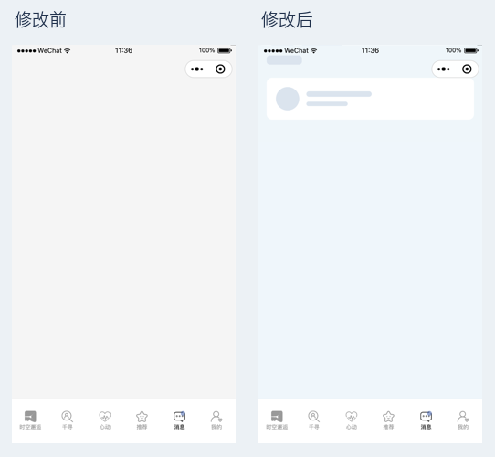

# 安卓微信底栏切换首帧白屏验证

用户在安卓手机扫描 `2026.11.19.1108` 预览码后，点击底部栏目会先看到整屏空白。本次构建为 `2026.11.19.1134`，代码提交为 `37506ed1`。

## 复现与修复

旧包的 5 个底栏原生页面只渲染 Taro 模板。首次显示时根节点的子节点数都是 0，从原生页面加载到首批业务数据提交，开发者工具实测间隔为 18～25 毫秒。已打开的页面再次显示时已有业务节点。千寻和时空邂逅共用一个原生页面。

新包在微信页面模板内提供静态布局，并为各页面设置与界面相应的底色。首次打开或重建页面时，微信可以在业务数据到达前绘制布局。同一次数据更新会显示业务内容并移除占位。微信静态首屏缓存只涉及初始布局。

## 模拟器与构建验证

使用微信开发者工具 Nexus 5X 预设，视口为 411 × 731。模拟器测试副本使用本机数据，体验构建使用项目正常接口配置。

| 场景 | 验证结果 |
| --- | --- |
| 从心动点进消息，暂缓消息页首批数据 | 在两版均无业务子节点时截图。旧包显示接近纯色的页面，新包已显示页面轮廓。释放数据后，两版均能进入消息页。 |
| 5 个页面首次打开，首批数据延迟 650 毫秒 | 新包取得 25 次数据到达前的布局采样，每次布局均覆盖整个视口。数据到达后全部移除占位，业务视图可见。 |
| 按正常速度往返 6 个底栏入口 | 完成 11 次实际底栏点击，5 个原生页面各加载一次。切回时都保留了业务节点，测得的业务视图均覆盖视口。 |
| 微信 WXML 编译器对照 | 两版、5 个页面、4 种数据状态共 40 项通过，覆盖无数据、空根节点、首次业务内容和已有内容刷新。 |
| 构建回归 | 构建前的 603 项 Node 测试通过。构建后校验通过，89 个页面各注册一次，主包及分包体积符合项目限制。 |

下图为同一模拟器同一路径的实际截图。为便于观察，两次都等截图完成后才放行消息页的首批数据。

## 微信上传核对

从同步后的 `master` 全新构建，核对独立发布目录中 443 个产物文件及项目配置的 SHA-256。上传前远端提交与构建提交一致。微信 CLI 已完成预览与上传，主包及分包共 14 个，名称和字节数逐项相同，合计 2,912,704 字节。

本机发布凭证和预览码位于 `.runtime/weapp-release-20261119-113420-37506ed1/`，模拟器记录位于 `.runtime/tab-first-paint-20261119/`。安卓真机显示效果待复验。供此次复验使用的二维码为该版本的微信预览码。
